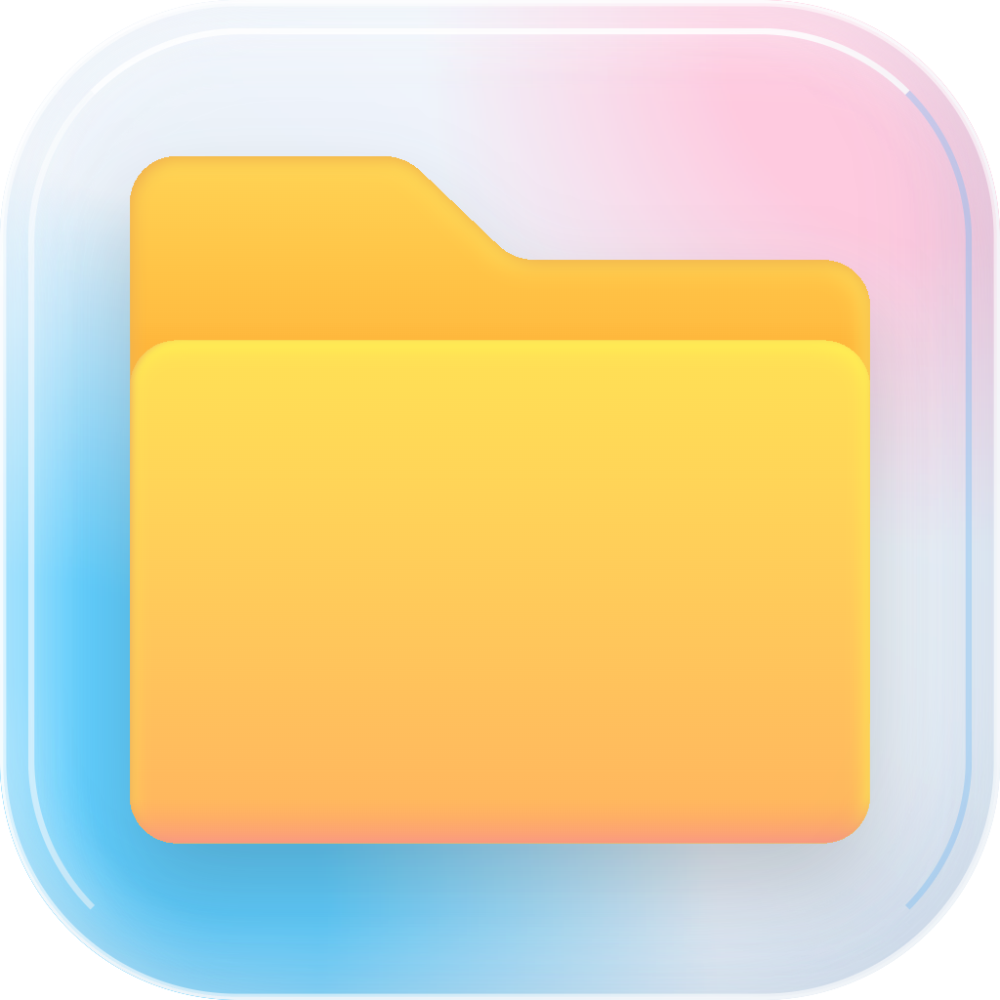

<div align="center">
  
  <h1>Mac Explorer</h1>
  <p><a href="README.md">简体中文</a> &nbsp;·&nbsp; <a href="README.zh-TW.md">繁體中文</a> &nbsp;·&nbsp; <strong>English</strong></p>
  <h3>Familiar workflows. A Mac experience.</h3>
  <p>A native macOS file manager that brings familiar Windows file management habits to your Mac.<br>From work documents to personal photos, built for the files you work with every day.</p>
  <p>
    <a href="#download-and-install"><strong>Quick install</strong></a> &nbsp;·&nbsp;
    <a href="#everyday-essentials-within-reach">Features</a> &nbsp;·&nbsp;
    <a href="https://github.com/qixiaoyu27/Mac-Explorer/releases">Release notes</a>
  </p>
  <p><sub>macOS 13 or later · Apple Silicon (M series) · Free and open source</sub></p>
</div>

<br>


<p align="center"><sub>This screenshot shows an early version. The current interface may differ.</sub></p>

Switching to a Mac brings plenty of new things to enjoy, along with habits you already rely on: finding files in a folder tree, pasting a path to jump straight to a destination, or cutting and pasting between folders. Mac Explorer keeps those habits within reach so you can focus on what you are doing.

Whether you are sorting a week's downloads, choosing travel photos, or switching between projects, you can start with familiar workflows and gradually make the views, toolbar, and keyboard shortcuts your own.

## Download and install

Open Terminal and run:

```sh
/bin/bash -c "$(curl -fsSL https://raw.githubusercontent.com/qixiaoyu27/Mac-Explorer/refs/heads/main/scripts/install-homebrew.sh)"
```

The command installs Homebrew if needed, then installs Mac Explorer. If the app is already installed, it checks for updates and updates it while preserving your personal files and preferences. Run the same command to check for updates later. Installing Homebrew for the first time may require your Mac login password.

<sub>The app supports macOS 13 or later on Apple Silicon (M series). See the [Homebrew website](https://brew.sh/) for Homebrew's own system requirements.</sub>

> **Opening for the first time**
> The current version is not notarized by Apple. If macOS blocks it from opening, confirm that you downloaded it from this repository, then allow it in System Settings → Privacy & Security. If macOS explicitly reports malware, do not continue.

<details>
<summary>Install manually with a DMG</summary>

1. Visit the [download page](https://github.com/qixiaoyu27/Mac-Explorer/releases/latest) and choose the **DMG** installer.
2. Open the DMG and drag **Mac Explorer** into **Applications**. Quit the previous version before updating.
3. Open the app and grant access to your Desktop, Documents, or Downloads folders as needed.

</details>

<details>
<summary>Upgrade from an earlier version</summary>

To upgrade from an earlier Electron version, run the command above. The old in-app updater cannot complete this migration automatically.

Your personal files are unaffected. Preferences such as appearance, keyboard shortcuts, and window sessions need to be set up again. You can import your favorites again through Settings → General → Import Favorites from Finder.

</details>

## Everyday essentials, within reach

File management fills many small moments throughout the day: finding a downloaded attachment, checking a document, or handing organized files to a colleague. Those small tasks deserve tools that feel natural.

<table>
  <tr>
    <td width="50%" valign="top">
      <h3>Browse with everything in order</h3>
      <p>Downloads in one place, finished work in a project folder, references somewhere else. Keep each location open in its own tab, browse the folder tree, or enter a path to go straight there.</p>
      <p>Pin frequently used folders to Quick Access or import your Finder favorites to keep familiar locations close at hand.</p>
    </td>
    <td width="50%" valign="top">
      <h3>Find the right view</h3>
      <p>Use large icons to pick photos, or names, dates, and sizes to organize documents. Eight views suit different kinds of content, and each folder remembers its layout and sort order.</p>
      <p>Not sure whether a file is the one you need? Press Space for a quick preview before deciding.</p>
    </td>
  </tr>
  <tr>
    <td width="50%" valign="top">
      <h3>Organize with familiar actions</h3>
      <p>File away scattered downloads, give documents clear names, and package files for sharing. Cut, paste, drag and drop, rename, and undo work in a familiar sequence.</p>
      <p>Browse an archive before extracting it, or create a ZIP directly when you need to share files.</p>
    </td>
    <td width="50%" valign="top">
      <h3>Make it your own</h3>
      <p>Choose a light or dark appearance, or follow your system setting. Simplified Chinese, Traditional Chinese, and English let you work in a familiar language.</p>
      <p>Keep frequent actions on the toolbar and customize keyboard shortcuts to suit the way you work.</p>
    </td>
  </tr>
  <tr>
    <td width="50%" valign="top">
      <h3>Different locations, one place to browse</h3>
      <p>Local documents, iCloud Drive, external disks, and network shares each have their uses. Reach them through familiar navigation without searching for a different entry point each time.</p>
      <p>From personal files to shared folders, give everyday organization a clear starting point.</p>
    </td>
    <td width="50%" valign="top">
      <h3>Check project details as you work</h3>
      <p>When working on code projects, use Git / SVN integration to inspect file status and differences and perform version control actions as needed.</p>
      <p>When you do not need these features, turn off detection and focus on the files in front of you.</p>
    </td>
  </tr>
</table>

<br>

## Familiar, with room for your choices

### At home alongside Finder

Keep using Finder, and open Mac Explorer when you want a folder tree, multiple tabs, or a familiar cut-and-paste workflow. They can coexist, so you do not have to change every habit at once. macOS still manages folder access permissions, and you choose which system integrations to enable.

### Care for every file you organize

Files hold your work, and sometimes photos you only had one chance to take. Regular deletion moves files to the system Trash. Copying, moving, and extracting files will not silently overwrite files with the same name. Clear results and visible confirmations where they matter are part of the experience we value.

### Free, open source, and shaped together

Use it freely, read the source, suggest improvements, or contribute to development. An awkward interaction or an unclear message is worth discussing. By paying attention to these small details, we hope to make Mac Explorer more useful over time.

<details>
<summary>Common keyboard shortcuts</summary>

| Action | Shortcut |
| --- | --- |
| Copy / Cut / Paste | ⌘C / ⌘X / ⌘V |
| New tab | ⌘T |
| Go to folder | ⇧⌘G |
| Search | ⌘F |
| Rename | Return or F2 |
| Quick Look | Space |
| Move to Trash | ⌘⌫ |
| Open settings | ⌘, |

Find more actions and customization options in the app menus and settings.

</details>

## Feedback and contributions

If a step makes you pause, or a familiar action still feels awkward, please [let us know](https://github.com/qixiaoyu27/Mac-Explorer/issues). Describing what you were trying to do and what happened helps us understand the problem. For bug reports, include the app version, macOS version, and steps to reproduce, and remove any private information.

Contributions to code, testing, and documentation are welcome. See the [development guide](native/README.md) and [contribution guidelines](AGENTS.md). Thank you to everyone who takes the time to try the app, share feedback, and contribute to making this project better.

<details>
<summary>Versioning policy</summary>

<a id="versioning-policy"></a>

We follow SemVer: PATCH for compatible fixes, MINOR for compatible features, and MAJOR for incompatible changes. Version numbers change only for official GitHub releases, not for everyday development, testing, or local builds. Published versions, tags, and release assets are never overwritten.

</details>

---

[AGPL-3.0 license](LICENSE) · Interface icons include [Lucide artwork (ISC)](native/ICON-LICENSE.txt)
