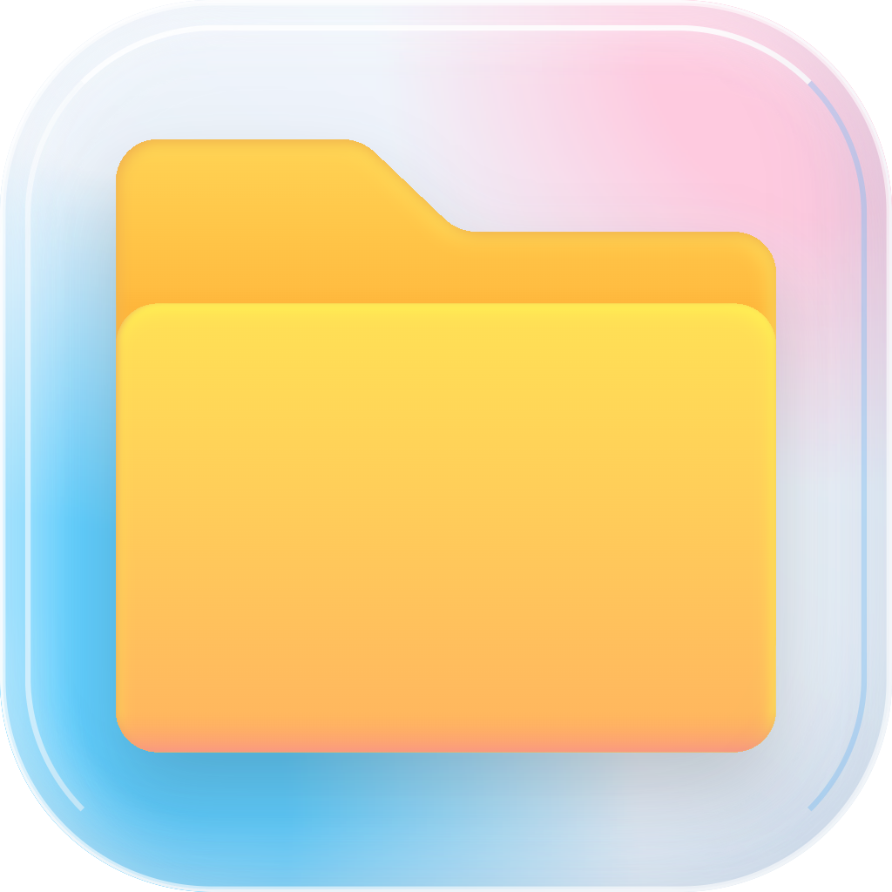

<div align="center">
  
  <h1>Mac Explorer</h1>
  <p><a href="README.md">简体中文</a> &nbsp;·&nbsp; <strong>繁體中文</strong> &nbsp;·&nbsp; <a href="README.en.md">English</a></p>
  <h3>熟悉的操作，Mac 的體驗。</h3>
  <p>一款原生 macOS 檔案管理器，讓熟悉的 Windows 檔案管理習慣，在 Mac 上延續。<br>從工作文件到生活照片，為每天與檔案打交道的你而做。</p>
  <p>
    <a href="#下載與安裝"><strong>一鍵安裝</strong></a> &nbsp;·&nbsp;
    <a href="#日常所需觸手可及">功能一覽</a> &nbsp;·&nbsp;
    <a href="https://github.com/qixiaoyu27/Mac-Explorer/releases">更新紀錄</a>
  </p>
  <p><sub>macOS 13 及以上 · Apple Silicon（M 系列）· 免費開源</sub></p>
</div>

<br>


<p align="center"><sub>圖示為早期版本，目前版本介面以實際應用程式為準。</sub></p>

換到 Mac，有很多值得喜歡的新體驗，也有一些早已順手的習慣：沿著目錄樹找檔案，複製一段路徑直達目的地，在幾個資料夾之間剪下、貼上。Mac Explorer 希望把這些習慣延續下來，讓你把注意力留給手邊的事情。

無論是整理一週的下載、挑選旅行照片，還是在多個專案之間切換，你都可以用熟悉的方式開始，再慢慢把檢視、工具列和快速鍵調整成自己的樣子。

## 下載與安裝

開啟「終端機」，執行：

```sh
/bin/bash -c "$(curl -fsSL https://raw.githubusercontent.com/qixiaoyu27/Mac-Explorer/refs/heads/main/scripts/install-homebrew.sh)"
```

自動安裝所需的 Homebrew，再安裝 Mac Explorer；已有應用程式會檢查並更新，保留個人檔案和偏好設定。之後檢查更新也執行同一條指令。首次安裝 Homebrew 時可能需要輸入 Mac 登入密碼。

<sub>應用程式支援 macOS 13 及以上 · Apple Silicon（M 系列）；Homebrew 本身的系統需求以其[官網](https://brew.sh/)為準。</sub>

> **首次開啟**
> 目前版本尚未經過 Apple 公證。若 macOS 阻止開啟，請確認下載來源為本儲存庫，再到「系統設定 → 隱私權與安全性」允許開啟。若系統明確提示惡意軟體，請勿繼續執行。

<details>
<summary>也可以手動安裝 DMG</summary>

1. 前往 [下載頁面](https://github.com/qixiaoyu27/Mac-Explorer/releases/latest)，選擇 **DMG** 安裝套件。
2. 開啟 DMG，將 **Mac Explorer** 拖入 **Applications（應用程式）**。更新時請先結束舊版本。
3. 開啟應用程式，依需要允許存取桌面、文件或下載項目資料夾。

</details>

<details>
<summary>從早期版本升級</summary>

從早期 Electron 版升級時，執行上方指令即可。舊版應用程式內的更新器無法自動完成此次遷移。

個人檔案不受影響。外觀、快速鍵和視窗工作階段等偏好需要重新設定；喜好項目可透過「設定 → 一般 → 從 Finder 匯入喜好項目」重新匯入。

</details>

## 日常所需，觸手可及

檔案管理貫穿一天裡許多細小的時刻。找到剛下載的附件，確認一份文件，把整理好的資料交給同事——這些小事，值得一套順手的工具。

<table>
  <tr>
    <td width="50%" valign="top">
      <h3>瀏覽，井然有序</h3>
      <p>資料在下載目錄，成品在專案資料夾，參考內容又放在另一處。用多個分頁保留各自的位置，沿目錄樹瀏覽，或輸入路徑直達目的地。</p>
      <p>把常用資料夾釘選到快速存取，也能匯入 Finder 喜好項目，讓熟悉的位置隨手可達。</p>
    </td>
    <td width="50%" valign="top">
      <h3>檢視，恰到好處</h3>
      <p>挑照片時看大圖示，整理文件時看名稱、日期和大小。八種檢視適應不同內容，每個資料夾記住自己的配置與排序。</p>
      <p>不確定是不是要找的檔案？按下空白鍵快速預覽，看過之後再決定。</p>
    </td>
  </tr>
  <tr>
    <td width="50%" valign="top">
      <h3>整理，順手完成</h3>
      <p>把零散的下載歸檔，為文件改個清楚的名稱，將準備好的資料打包。剪下、貼上、拖放、重新命名與復原，延續熟悉的操作順序。</p>
      <p>收到壓縮檔時，先瀏覽內容再決定解壓縮；需要分享時，也可以直接建立 ZIP。</p>
    </td>
    <td width="50%" valign="top">
      <h3>習慣，由你定義</h3>
      <p>喜歡明亮清晰，或習慣深色環境，都可以選擇，也可以跟隨系統。簡體中文、繁體中文與英文，讓介面用你熟悉的語言表達。</p>
      <p>將常用操作留在工具列，把快速鍵調成順手的組合，讓工具配合你的節奏。</p>
    </td>
  </tr>
  <tr>
    <td width="50%" valign="top">
      <h3>不同位置，一處瀏覽</h3>
      <p>本機文件、iCloud Drive、外接磁碟和網路共享，各有各的用途。用熟悉的導覽方式存取這些位置，減少來回尋找入口。</p>
      <p>從個人資料到共享資料夾，讓日常整理有一個清晰的起點。</p>
    </td>
    <td width="50%" valign="top">
      <h3>專案細節，隨時查看</h3>
      <p>處理程式碼專案時，透過 Git / SVN 整合查看檔案狀態與差異，依需要完成版本管理操作。</p>
      <p>不需要這些功能時，可以關閉偵測，將注意力留給眼前的檔案。</p>
    </td>
  </tr>
</table>

<br>

## 熟悉，也尊重你的選擇

### 和 Finder 一起，各得其所

你可以繼續使用 Finder，也可以在需要目錄樹、多分頁或熟悉的剪下貼上流程時開啟 Mac Explorer。它們可以共存，不必一次改變所有習慣。資料夾存取權限仍由 macOS 管理，系統整合功能由你主動開啟。

### 認真對待每一次整理

檔案裡裝著工作成果，也可能是只拍過一次的照片。一般刪除會移至系統垃圾桶；複製、移動與解壓縮遇到同名檔案時，不會默默覆寫。處理檔案時，讓結果清楚、讓必要的確認被看見，是我們看重的基本體驗。

### 免費開源，一起慢慢打磨

你可以自由使用，也可以查看原始碼、提出改進或參與開發。一處不順手的互動、一則不夠清楚的提示，都值得被認真討論。我們希望在這些具體的小事裡，讓 Mac Explorer 越來越好用。

<details>
<summary>常用快速鍵</summary>

| 操作 | 快速鍵 |
| --- | --- |
| 複製 / 剪下 / 貼上 | ⌘C / ⌘X / ⌘V |
| 新增分頁 | ⌘T |
| 前往資料夾 | ⇧⌘G |
| 搜尋 | ⌘F |
| 重新命名 | Return 或 F2 |
| 快速查看 | Space |
| 移至垃圾桶 | ⌘⌫ |
| 開啟設定 | ⌘, |

更多操作與自訂選項可在應用程式選單和設定中查看。

</details>

## 意見回饋與參與

如果某個步驟讓你停下來想了想，或某個熟悉的操作還不夠順手，歡迎 [告訴我們](https://github.com/qixiaoyu27/Mac-Explorer/issues)。描述你當時想做什麼、遇到了什麼，會幫助我們理解問題；回報問題時，請附上應用程式與 macOS 版本、重現步驟，並隱去私人資訊。

也歡迎參與程式碼、測試和文件改進，相關說明見 [開發文件](native/README.md) 與 [貢獻約定](AGENTS.md)。感謝每一位願意花時間試用、回饋和貢獻的人，讓這個專案一點點變得更完善。

<details>
<summary>版本策略</summary>

<a id="版本策略"></a>

採用 SemVer：相容修復更新 PATCH，相容功能更新 MINOR，不相容變更更新 MAJOR。版本號僅在正式發布到 GitHub 時更新，日常開發、測試和本機建置不遞增；已發布版本、tag 和附件不覆寫。

</details>

---

[AGPL-3.0 開源授權](LICENSE) · 介面圖示包含 [Lucide artwork（ISC）](native/ICON-LICENSE.txt)
